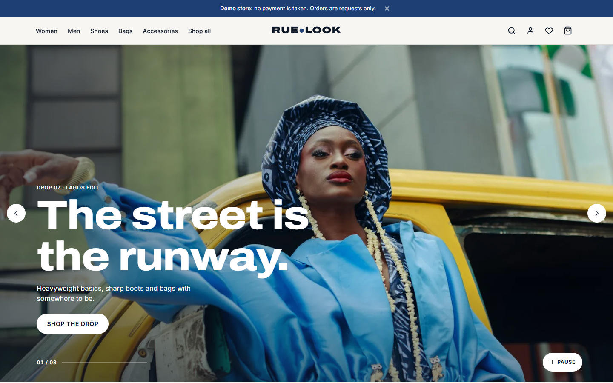
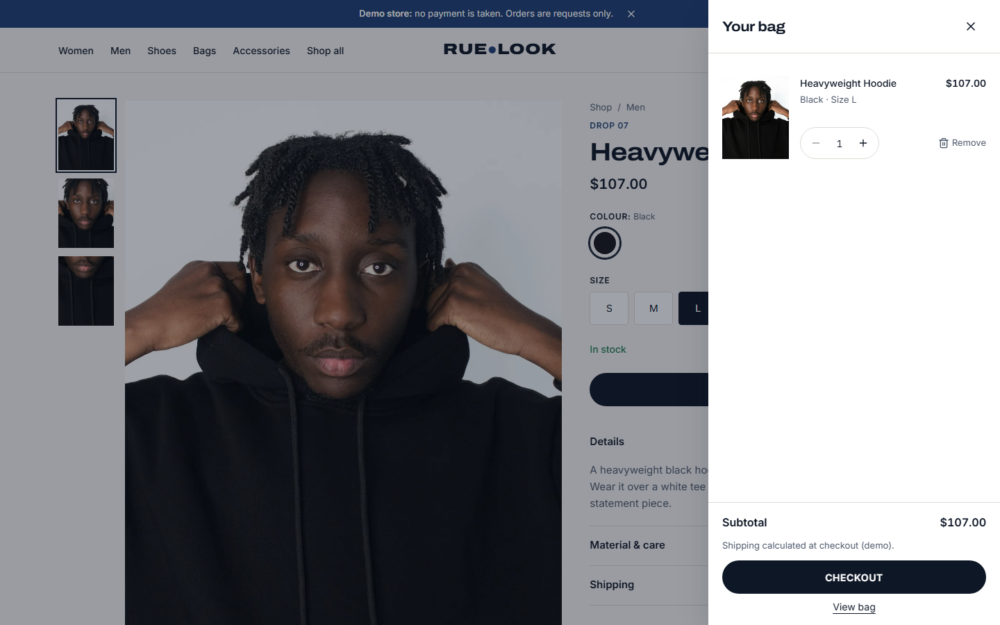

# Ruelook

**Streetwear, picked for quality.** An editorial e-commerce demo store with an AI Stylist that completes the look, built for shoppers in English-speaking West Africa and beyond.



**Live demo:** https://badersalis.github.io/ruelook/ *(deployment pending; see Status)*
**Designed & built by [bader.salis](https://www.behance.net/theawesomebss)**

> Demo store: no payment is taken and nothing ships. Products, prices and orders are fictional; photography via Unsplash.

## What it does
- **Catalogue**: 40 products across Women, Men, Shoes, Bags and Accessories, with category filters, price sort, search and "load more".
- **Product pages**: gallery with zoom, colour and size pickers with stock states, and a sticky mobile buy bar.
- **AI Stylist, "Complete the look"**: three outfits built around the piece you're viewing, each with a one-line rationale. Add any item, or add the full look through a guided size picker.
- **Bag and checkout**: persistent bag, quick add, then an order *request* (no payment). Prices and stock are checked server-side.
- **Accounts**: email and password or magic link, a wishlist, and order history. A guest bag merges into the account on sign-in.
- **Admin**: product CRUD with image upload and reordering, plus order processing (`requested → confirmed → shipped → completed`, or `cancelled`) with stock reserved on confirm.



## Stack
| Layer | Choice |
|---|---|
| UI | Next.js 16 App Router (**static export**), React 19, TypeScript, Tailwind CSS v4 |
| Data | Supabase: Postgres with Row Level Security on every table, Auth, Storage; 3 `security definer` RPCs for checkout and order status |
| State | TanStack Query, Zustand (persisted bag) |
| AI | Local **Llama 3.1 8B via Ollama**. The live site serves looks pre-generated locally and stored in Supabase (demo mode); local dev can generate them live |
| Motion | Custom hero wipe, look-board assembly and fly-to-bag, each with a `prefers-reduced-motion` fallback |
| Quality | Vitest (39 unit tests), Playwright (10 journeys × desktop/mobile), a 32-check SQL authorization suite |
| Hosting | GitHub Pages via GitHub Actions, with a post-deploy smoke test against the live URL |

## Run it locally
```bash
npm ci
npm run dev                 # http://localhost:3000 (demo AI mode by default)
```
Live AI in local dev (optional):
```bash
ollama pull llama3.1:8b
# Let the browser call Ollama from the dev origin:
OLLAMA_ORIGINS=http://localhost:3000 ollama serve
NEXT_PUBLIC_AI_MODE=local npm run dev
# CPU-only machines: NEXT_PUBLIC_AI_NUM_GPU=0 NEXT_PUBLIC_AI_TIMEOUT_MS=90000
```
Quality gates:
```bash
npm run lint && npm run typecheck && npm test
NEXT_PUBLIC_BASE_PATH=/ruelook npm run build
npx playwright test          # serves ./out under /ruelook
```
Configuration is public only (`NEXT_PUBLIC_*`); defaults live in `src/lib/config.ts`. The Supabase publishable key is safe in the browser because RLS enforces access. **Never** add the service-role key to this repo or to CI.

## Project docs
- Brief and acceptance criteria: [docs/project-brief.md](docs/project-brief.md)
- Requirements: [docs/requirements.md](docs/requirements.md)
- Architecture: [docs/architecture/system-overview.md](docs/architecture/system-overview.md)
- Threat model: [docs/security/threat-model.md](docs/security/threat-model.md)
- Visual direction and UX spec: [docs/design/](docs/design/)
- Test plan and results: [docs/test-plan.md](docs/test-plan.md)
- Decisions: [docs/decision-log.md](docs/decision-log.md)

## Status
Built and tested locally. The repository push and Pages deployment are waiting on GitHub authentication; see [docs/pipeline-status.md](docs/pipeline-status.md).

---
Designed & built by **bader.salis**: product design, front end, backend and AI integration.
