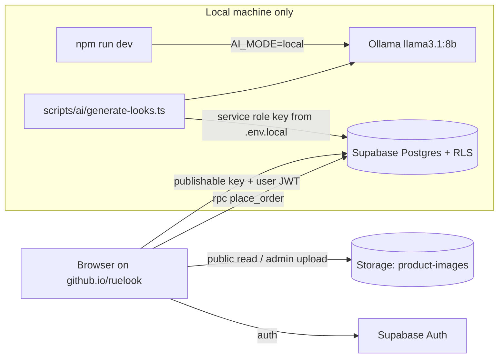

# System Overview: Ruelook v1

## Context and users
Editorial streetwear store (demo). Shoppers browse, save, bag and place order requests; admins manage the catalogue and orders. Scope: `docs/requirements.md`. No payments, no real customer data.

## Functional requirements
F1–F6 in `docs/requirements.md` (catalogue, PDP, AI Stylist, bag + order-request checkout, auth/wishlist/account, admin).

## Non-functional requirements
- Static hosting on GitHub Pages (no server runtime). Base path `/ruelook`.
- Security boundary = Postgres RLS + `security definer` RPCs (publishable key in the browser).
- Performance: LCP < 2.5 s mobile on home; JS first-load ≤ 180 kB gzip on home; images responsive WebP.
- Accessibility WCAG 2.2 AA. Free tiers only.

## Proposed stack and rationale
| Layer | Choice | Why |
|---|---|---|
| App | Next.js 15 App Router, `output: 'export'`, TypeScript strict, Tailwind CSS v4 | Toolkit default; static export → Pages |
| Data fetching | `@supabase/supabase-js` in the browser + TanStack Query (cache, retries, loading/error states) | No server; declarative states the UX spec needs |
| Client state | Zustand (bag, persisted to localStorage) | Tiny; guest cart without a server |
| Forms/validation | react-hook-form + zod (shared schemas with the AI adapter) | Accessible error wiring, typed |
| Motion | CSS + Web Animations API; `motion` (Framer Motion) only if prototypes show a need | Lowest rung first (creative-technologist) |
| Icons | lucide-react | Visual direction |
| Backend | Supabase free tier: Postgres 17, Auth (email+password, magic link), Storage | Toolkit default |
| AI | Ollama `llama3.1:8b` (local) behind `src/lib/ai/`; `demo` mode reads `ai_looks` | Local-llm skill; Pages can't reach localhost |
| Tests | Vitest + Testing Library; Playwright (local + live URL); SQL RLS tests via `scripts/test-rls.ts` (two real test users) | Evidence for AC-6/AC-7 |

## Component boundaries
```
src/
  app/                    routes (all client-rendered data; static shells)
    (store)/ page.tsx, shop/, product/, bag/, checkout/, wishlist/, account/
    admin/                guarded client-side by role + enforced by RLS
  components/ui/          design-system primitives (Button, Tabs, Sheet, Drawer, Input…)
  components/store/       ProductCard, Hero, PromoBento, Gallery, SizePicker, CartDrawer, LookBoard…
  components/admin/       ProductForm, ImageUploader, OrdersTable…
  components/fx/          signature effects (creative-technologist owns)
  lib/supabase/           client, typed queries (database.types.ts generated)
  lib/ai/                 provider interface, ollama.ts, demo.ts, prompts/, schemas
  lib/cart/               Zustand store + merge-on-login
  styles/                 tokens.css (from Figma variables), motion.css (fx owner)
scripts/                  seed (products, images → Storage), ai/generate-looks.ts, test-rls.ts
supabase/migrations/      SQL migrations (source of truth, also applied via MCP)
```

## Data flow


## Data model
| Table | Key columns | Notes |
|---|---|---|
| `categories` | id, slug (women, men, shoes, bags, accessories), name, sort | seed |
| `products` | id uuid, slug unique, name, category_id, description, material_care, price_cents int ≥ 0, status (`draft`/`published`/`archived`), drop_label, created_at, updated_at | `pg_trgm` index on name for search |
| `product_colors` | id, product_id, name, hex, sort | |
| `product_variants` | id, product_id, color_id, size, stock int ≥ 0 | unique(product_id, color_id, size) |
| `product_images` | id, product_id, path (Storage key), alt, sort, color_id null | widths 800/1600 WebP generated at upload/seed |
| `profiles` | id = auth.users.id, full_name, phone, role (`shopper`/`admin`) | row created by trigger on signup; role not user-editable |
| `cart_items` | user_id, variant_id, qty 1–10 | pk(user_id, variant_id) |
| `wishlist_items` | user_id, product_id, created_at | pk(user_id, product_id) |
| `orders` | id, number (`RL-` + 6 chars), user_id null, guest_token uuid, email, full_name, phone, country, city, address, status (`requested`/`confirmed`/`shipped`/`completed`/`cancelled`), subtotal_cents, created_at | inserted only via RPC |
| `order_items` | id, order_id, product_id, variant_id, name, color, size, unit_price_cents, qty | price snapshot |
| `ai_looks` | id, product_id, look_index 1–3, title, rationale, item_product_ids uuid[] (2–4), model, prompt_version, generated_at | demo-mode source for AC-8 (D-007) |

**RPCs (security definer, `search_path` pinned):**
- `place_order(items jsonb, contact jsonb) returns (number, guest_token)`: validates the variants exist, are published and qty ≤ stock; prices from `products` (never the client); writes the order + items; links `auth.uid()` if signed in; rate limit: max 5 orders per email per hour.
- `get_order(number, token)`: returns one order for guest confirmation (token match) or owner.
- `admin_set_order_status(order_id, status)`: admin only, valid transitions only; decrements stock on `confirmed`, restores it on `cancelled` after confirmation.
- `is_admin()`: `stable`, reads `profiles.role` for `auth.uid()`.

Stock is not reserved by a `requested` order (demo visitors must not drain the catalogue); it is decremented when an admin confirms.

## RLS rules (summary)
| Table | anon | authenticated | admin |
|---|---|---|---|
| categories, products (+colors, variants, images), ai_looks | select where product `published` | same | all (via `is_admin()`) |
| profiles | — | select/update own (role column excluded by a trigger guard) | select all |
| cart_items, wishlist_items | — | all on own rows (`user_id = auth.uid()`) | select |
| orders, order_items | — (RPC only) | select own (`user_id = auth.uid()`) | select all; update via RPC |
| storage `product-images` | read | read | insert/update/delete |

## API and integrations
Supabase PostgREST + RPC only (no custom HTTP API, so no Postman collection needed). Ollama only in local dev and scripts.

**AI Stylist pipeline:**
1. `scripts/ai/generate-looks.ts` loops over published products.
2. It builds a prompt with the product + a candidate list of ≤ 40 in-stock products from complementary categories (id, name, category, colour).
3. It asks for 3 looks as JSON `{looks:[{title, rationale, item_ids[2..4]}]}` and validates with zod (ids must be in the candidate list, no duplicates, rationale ≤ 160 chars), retrying once with the error.
4. The Delivery Lead spot-checks the output, then the script upserts into `ai_looks` with model + prompt version.

In local mode the PDP "Regenerate" calls the same function from the browser (`OLLAMA_ORIGINS=http://localhost:3000`).

## Trust boundaries
1. Browser ↔ Supabase (untrusted client; RLS/RPC enforce everything).
2. Admin vs shopper (role in `profiles`, set manually for the demo admin account).
3. Local scripts with the service-role key (local machine only; never in CI or the bundle).
4. LLM output (untrusted text: schema-validated, rendered as text, ids whitelisted).

## Deploy target
GitHub Actions: lint → typecheck → test → `next build` (static export, `NEXT_PUBLIC_BASE_PATH=/ruelook`, `NEXT_PUBLIC_AI_MODE=demo`) → upload to Pages. `trailingSlash: true`, `images.unoptimized: true`. Supabase URL + publishable key as repo variables.

## Reliability and operations
- Free Supabase projects pause after a week of inactivity. Runbook: restore from the dashboard; an optional weekly GitHub Actions "keep-alive" ping (a free read of `categories`) can prevent it (D-008).
- Backups: migrations + seed scripts in the repo can rebuild the demo from scratch.

## Cost assumptions
$0: GitHub Free (public repo, Pages, Actions minutes), Supabase Free (500 MB DB, 1 GB storage, 50k MAU), Unsplash free, Ollama local. Auth emails use Supabase's built-in SMTP, which is rate-limited (a few emails per hour), so the demo provides a pre-confirmed demo shopper account and documents the limit.

## Open risks
- Built-in email rate limits affect magic links/sign-up confirmation → demo accounts + documented limit; custom SMTP would be a later free/paid choice.
- Query-string product URLs are less SEO-friendly (acceptable for a demo; D-006).
- `ai_looks` can go stale if the catalogue changes → regenerate script + a UI re-check of stock at render.
